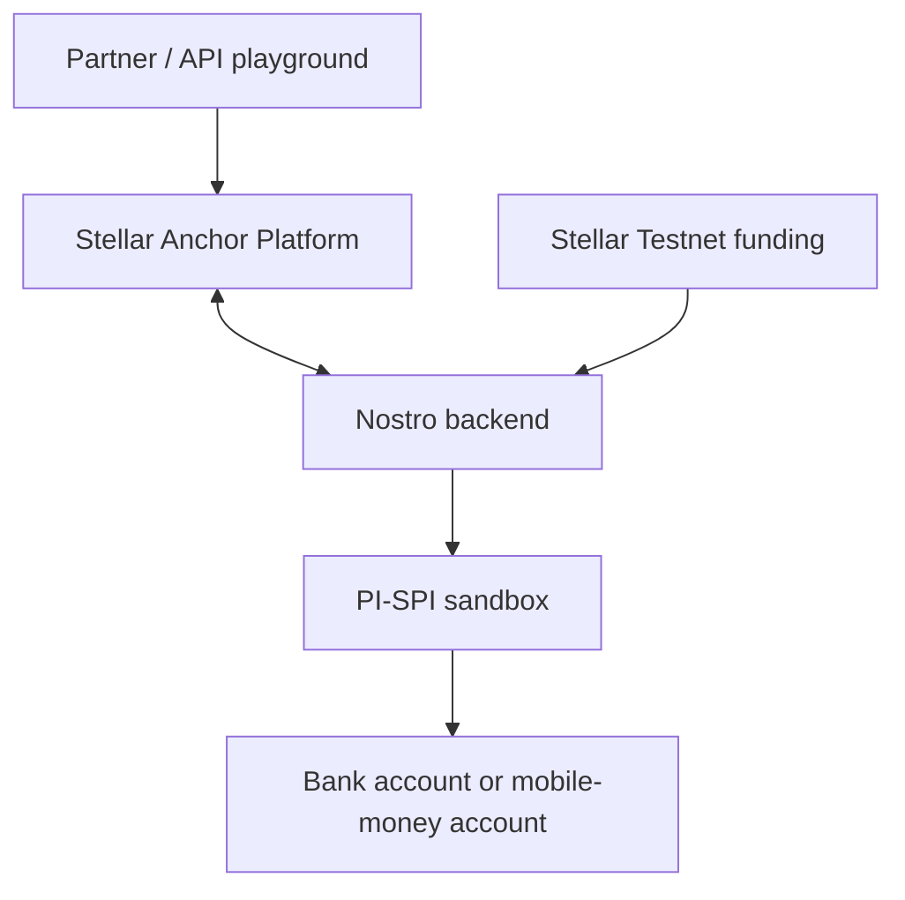

Nostro is building an anchor that connects Stellar-based payment partners to bank accounts and mobile-money wallets in West Africa. **This working sandbox** connects USDC funding on Stellar Testnet to XOF payments into PI-SPI test accounts. You can complete the flow from this site.

## What is this demo?

- **Official Stellar Anchor Platform:** authentication, customer registration, quotes and payment tracking through Stellar Ecosystem Proposals (SEPs). We use version **2.11.2**, a pinned container image and [source reference `a551cea`](https://github.com/stellar/anchor-platform/commit/a551cea2fb801d52cce2528be7e60f0620e57bfa).
- **Stellar Testnet:** the public test network records funding in Circle test USDC. No real money is involved.
- **PI-SPI:** the instant-payment infrastructure operated by BCEAO, the Central Bank of West African States. It connects participating banks and mobile-money issuers. This demo calls its **sandbox API** to credit test accounts. [PI-SPI overview](https://developer.pispi.bceao.int/guides/vue-ensemble).
- **BIMAO:** Banque des Institutions Mutualistes d’Afrique de l’Ouest. Our `BIMAO_SANDBOX` example routes to PI-SPI’s Banque Sénégal 999 test institution. The wallet example routes to EME Côte d’Ivoire 999. [About BIMAO](https://www.bimao.sn/mentions-legales/).

## Try a payment

Allow about ten minutes for your first walkthrough. You need no wallet, installation or API key.

<CardGroup cols={3}>
  <Card title="Run a payment" icon="play" href="/quickstart">Follow six steps in the API playground.</Card>
  <Card title="Test beneficiaries" icon="users" href="/test-beneficiaries">Choose a bank account or mobile-money wallet.</Card>
  <Card title="Errors & limits" icon="circle-info" href="/limits-and-errors">Check amounts, retries and error responses.</Card>
</CardGroup>

## How it works

**1. Session → 2. Customers → 3. Quote → 4. Payment → 5. Funding → 6. Tracking**

The Anchor Platform handles the Stellar API protocols. Nostro connects customer and quote data to a payment, checks its on-chain funding, initiates the PI-SPI payout, and reports the result back to the Anchor Platform.

## What this demonstrates

- SEP-10 authentication, including a sandbox helper that signs for the shared demo account.
- SEP-12 registration and status for predefined sender and receiver profiles.
- SEP-38 quotes and the SEP-31 payment lifecycle.
- On-chain funding with a clickable Stellar Testnet explorer link.
- Off-chain payout confirmation with a PI-SPI reference in `external_transaction_id`.

## About this sandbox

Hosted at **https://sandbox-api.nostro.finance**. The demo account is shared and rate limits apply. The fixed test rate is **500 XOF per USDC**, with zero service fees.

**What this is not**

- A production BIMAO or commercial mobile-wallet connection.
- Live customer identity verification: the demo accepts predefined test profiles.
- Live currency conversion: the PI-SPI payout account is funded separately from the Testnet wallet.

See [About this sandbox](/about-sandbox) for architecture, boundaries and the production roadmap.
